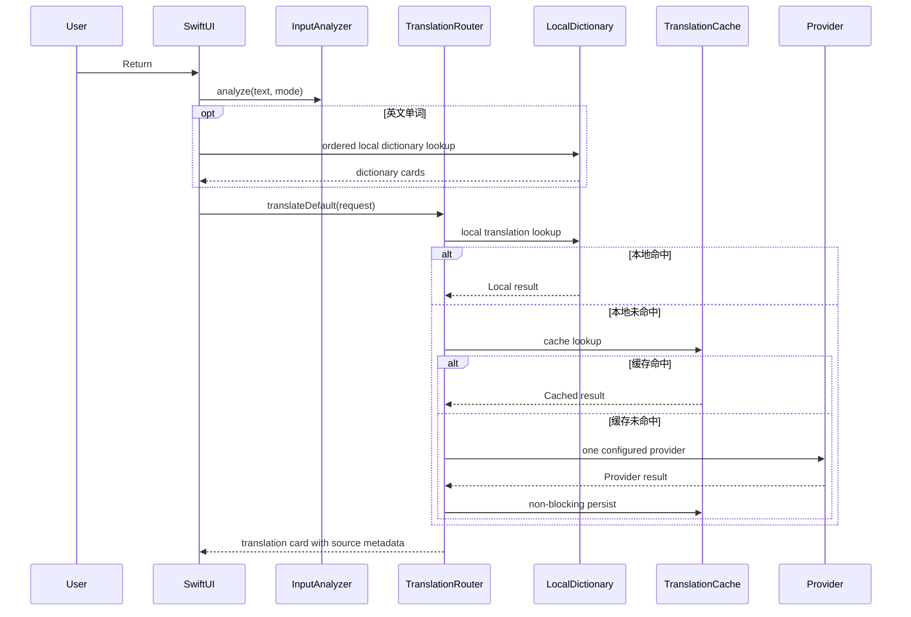

# 架构说明

## 产品边界

TranslateDesk 是一个集成“查词 + 翻译 + 表达优化”的工具，但三种能力拥有独立模型：

- **查词**读取已加载本地词典。
- **翻译**调用本地结果、缓存或远程翻译服务。
- **表达优化**基于用户选中的翻译结果，按场景调用 AI。

统一输入框只负责降低操作成本，不会把三种结果混成一种类型。

## 分层

### TranslateDesk

- `AppModel`：智能意图编排、页面状态、请求代际和配置操作。
- `TranslationWorkspaceView`：统一输入、智能/查词/翻译模式和分区结果。
- `SubmitTextEditor`：Return 提交、Shift+Return 换行、Command+Return 准确翻译。
- `SettingsView`：服务端点、模型、路由和 Keychain 配置。
- `ResultCards`：词典、翻译、表达三类独立卡片。

### TranslateCore

- `InputAnalyzer`：检测中英文、单词/短语/句子和建议动作。
- `TranslationRouter`：默认预设、准确服务、指定服务、缓存和回退。
- `ExpressionRouter`：根据场景选择 AI 服务。
- `ProviderFactory`：由配置生成服务适配器。
- `TranslationCache`：内存缓存及非阻塞合并持久化。
- `DictionaryCatalog`：按已加载顺序聚合每本词典的独立结果。
- `IndexedDictionarySource`：内存映射 `.tdict`，二分查询和前缀建议。
- `LocalDictionary`：原有工作常用词兜底。
- `ConfigurationStore`：JSON 配置持久化。

## 智能输入流程

```text
用户输入 + Return
        ↓
InputAnalyzer
        ├─ 中文内容 ───────────────→ 翻译为英文
        ├─ 英文单词 ─→ 本地词典查询 + 翻译为中文
        ├─ 英文短语/句子 ─────────→ 翻译为中文
        └─ 其他语言 ───────────────→ 翻译为中文
```

新输入会替换上一轮词典、翻译和表达主结果。用户主动调用准确翻译或指定服务时，结果追加在翻译区用于对比。

## 当前词典架构

```text
DictionaryCatalog
  ├─ Cambridge IndexedDictionarySource (63,762)
  ├─ Collins IndexedDictionarySource   (33,261)
  └─ LocalDictionary                   (6)
        ↓ 按固定顺序
DictionaryLookupResult[]
        ↓
每本词典独立卡片
```

两份 MDX 已在开发阶段转换为 `.tdict`：

```text
Header
Offset table
Sorted UTF-8 key index
UTF-8 text bodies
```

查询文件使用内存映射，精确词头通过二分定位，前缀建议通过 lower-bound 后顺序读取。运行时不解析 MDX，也不会把全部正文复制到内存。由于没有对应 MDD，转换器删除无效图片、脚本、样式和音频引用，保留可读文字内容。

词典链路不会参与远程翻译服务选择；英文单词可以同时得到词典卡片和独立翻译卡片。

## 翻译时序



## 结果溯源

`TranslationResult` 保存请求服务、实际服务、配置来源、模型、缓存状态、回退原因和耗时。UI 始终显示实际服务商。


## Result presentation state

`AppModel` parses each dictionary hit into a cached `DictionaryPresentation`. `DictionarySenseGrouper` provides stable part-of-speech groups. Result source filters and per-dictionary/group expansion preferences are stored separately in `UserDefaults`; they affect presentation only and never change lookup order or provider routing. A new query resets the filter to All; Smart queries also discard previous dictionary expansion state to avoid hiding the translation or opening long examples by default. Explicit dictionary mode keeps its detail preferences.

## 2026-11-05 本机翻译与交互修正

- 初始工作方式设为 **智能识别**：英文单词同时查本地词典并翻译，句子直接翻译；纯翻译模式不触发词典查询。
- 用户的源语言和目标语言选择保留 `auto` 语义；每次请求独立解析实际方向，不用上一次译文的语言覆盖选择。交换语言时允许直接以已有译文作为新原文。
- SwiftPM 运行态首先使用 `Bundle.module` 查询 `.tdict`，安装后的 `.app` 继续使用 `Contents/Resources`，三本词典合计 183,168 个词条索引。
- AI 请求明确区分 `source_text` 与只供消歧的 `context`，保留专业名词、标识符、占位符与换行；不额外存储原文或新建翻译后端。
- UI 始终展示自动/手动语言方向，并将已配置的高质量服务放到显式按次按钮。默认仍使用用户原有预设，不会自动切换到可能计费的服务。
- 朗读使用系统 `AVSpeechSynthesizer` 和按文本语言选择的声音；网络翻译准确率必须结合实际服务与人工样例验证，不能由单元测试推断。

### Keychain 启动隔离

`ProviderRuntimeStatus` 是 UI 唯一读取的派生状态；App 初始化和 SwiftUI 视图计算不再同步调用 `SecItemCopyMatching`。配置刷新先发布不依赖 Keychain 的状态，再从 utility 后台任务读取凭证可用性并回主线程更新。较旧的刷新结果不能覆盖新配置；真正的凭证值仍仅由 Keychain 管理，不复制到配置文件。这样 macOS 钥匙串询问授权时不会阻塞首次窗口创建。

### 单工作窗口：完整工作区 ↔ 快捷翻译（2026-11-12）

`AppLifecycleController` 是**唯一工作窗口 Owner**：只创建一个 `NSWindow` 和一个 `NSHostingController(RootView)`，不创建独立 `NSPanel`。`AppModel.isQuickPresentation` 是界面形态的唯一状态；`RootView` 在该窗口内选择 `TranslationWorkspaceView` 或 `QuickTranslationView`。输入、译文、词典、语言方向和翻译服务始终使用同一 `AppModel`，切换时不重新执行请求，也不丢失结果。系统原生 `Settings` 场景独立于工作窗口。

完整模式：宽窗口左侧模式导航 + 原文/结果双栏，较窄窗口自动变为顶部模式切换与上下布局；输入固定、结果独立滚动。快捷模式：520×380 初始大小（可在 440×310 到 700×620 内调整），在同一个 `NSWindow` 中显示单列输入、译文、简明词义、朗读和复制。主窗口缩小按钮与系统黄色窗口按钮均切为快捷形态；快捷窗口展开按钮恢复之前完整窗口的几何尺寸；用户对快捷窗口的手动调整在模式切换后保留。

`⌥A` 先读取外部应用选区，再以快捷形态显示**同一个窗口**；没有选区时保留工作区原文，不做清空。快捷窗口可以固定，未固定时失焦隐藏；Escape 隐藏而不退出应用。两种形态均通过现有 `SubmitTextEditor` 处理 Return、Shift+Return、Command+Return，只有 key window 可申请输入焦点。窗口按系统减少动态效果设置决定是否播放原生尺寸过渡。

翻译卡片仅展示译文和常用复制操作；服务请求路由、模型、来源、回退和耗时通过信息弹出层按需查看。Smart 模式字典分组默认折叠但显示简要义项，点击分组可展开全部内容。显示状态不改变翻译/词典请求路由。

### 智能模式双语词典路由（2026-11-05）

Smart 模式对中英文单词和未带句末标点的短语同时执行一次精确本地词典查询和常规翻译。查词只检索完整词条，未收录就不显示词典卡片，也不会使用词典第一义覆盖翻译结果；完整句子直接走翻译。纯翻译模式不查词。此处的精确检索开销很小：少量未加句号的短句可能进行一次未命中的词典检索，但 UI 仍只显示翻译。

实机例子：`take into account` 显示中文翻译及 Cambridge 英汉释义；`人工智能` 显示基础词典英译 `AI` 及 Collins 汉英标准义项 `artificial intelligence`。这两个结果有不同来源，不声称缩写与完整译文在所有语境下等价。词典收录不全时仅显示翻译，不能假设每个短语都可查询。
